<div align="center">


# AutoP

**A general-purpose operation agent that runs on your phone**

[](https://github.com/W1412X/autop/actions/workflows/release.yml)


[中文](README.md) · [English](README.en.md) · [Project site](https://autop.sharesdu.com) · [Download the latest APK](https://github.com/W1412X/autop/releases/latest)

</div>

Give AutoP a task in one sentence. It looks at the screen, acts on it, and uses a large language model to plan each step, so it can tap, swipe, type, and move across apps for you. The screen can be read from the accessibility node tree or an on-device vision model, and screenshots can also go straight to a model. Taps and swipes prefer node actions, and can also be injected through shell over wireless debugging, which is equivalent to real touch input. No root is needed. Any phone running Android 11 or later can use it.

It has no code paths written for specific apps. App-specific knowledge, such as operation manuals and rules for sensitive pages, is editable data, and the agent keeps adding to it as it works.

> For development and learning only. While running, screen content is sent to the **model service you configure yourself**. Read [Privacy and security](#privacy-and-security) before use.

<table>
  <tr>
    <td align="center" valign="top">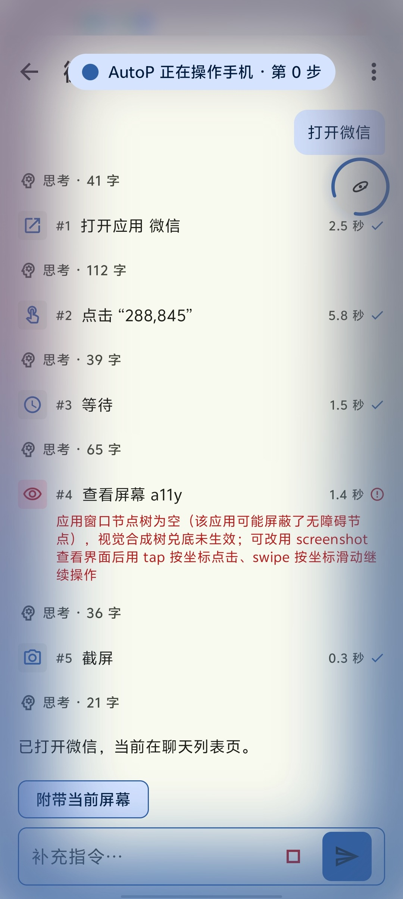<br><sub>Chat: expand any step to inspect it</sub></td>
    <td align="center" valign="top">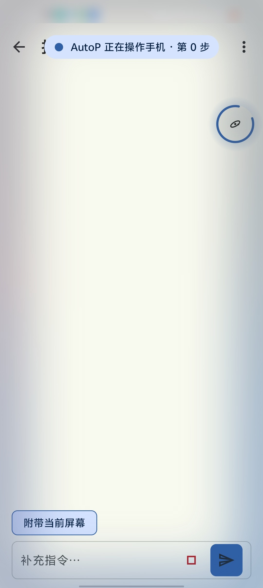<br><sub>While running: edge glow and step counter</sub></td>
    <td align="center" valign="top">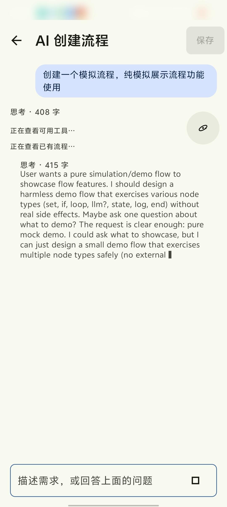<br><sub>AI flow creation: generated while it thinks</sub></td>
    <td align="center" valign="top">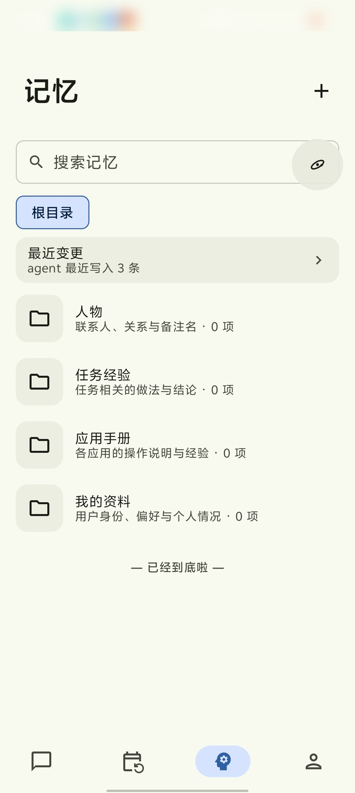<br><sub>Memory: organized by directory</sub></td>
  </tr>
</table>

## Contents

- [Features](#features)
- [How it works](#how-it-works)
- [Getting started](#getting-started)
- [Permissions](#permissions)
- [Privacy and security](#privacy-and-security)
- [Project structure](#project-structure)
- [Development guide](#development-guide)
- [Third-party dependencies and licenses](#third-party-dependencies-and-licenses)
- [CI and release](#ci-and-release)
- [Download](#download)
- [License](#license)

## Features

### Give a task in one sentence

Start a task from the chat page or the floating ball, for example "set the screen brightness to 50%" or "tell Zhang San in WeChat that tomorrow's meeting moves to 4 pm". The agent lists a plan and carries it out step by step. Each step can be expanded in the timeline to see the action, the observation, and the time it took. You can add instructions while it runs without interrupting the current action, or stop it with one tap.

### Reading the screen

The node tree is the cheapest option when it is available. When an app hides its nodes, the agent can switch to an on-device vision model, or pass a screenshot to a model. Actions also have several paths: node actions come first, and coordinate gestures can go through shell injection or accessibility injection.

| Observation mode | Source | Use case |
|---|---|---|
| `a11y` | Accessibility node tree, serialized as compact text with short IDs | Default, lowest cost |
| `visual` | Screenshot + on-device ONNX models (object detection, OCR, icon classification) | The app hides node information |

Both modes output the same 0–1000 normalized coordinates, so the action layer does not care where the picture came from. Use visual mode for cases such as an empty node tree, WebView, or games.

### Reliable taps and swipes

- **Node actions first**: when both observation and action come from accessibility, taps, long presses, and scrolls prefer the system's accessibility node actions. If an app rejects them, the agent falls back to coordinate gestures.
- **Per-app memory**: if an app accepts node actions but does not respond to them (the node is invalid while the gesture works), the agent records that after enough evidence and uses gestures for that app from then on. View or reset this under "Me → Node actions".
- **Scroll distance per container**: one step is like a finger swipe. The start and end points stay inside the scrollable area so the swipe does not fall outside it.
- **Fixed wait after each action**: every action waits a fixed time (5 seconds by default, adjustable), then returns the facts and execution record. The model confirms the screen state itself with observe.
- **Wireless debugging injection**: after pairing through wireless debugging (the Android ADB protocol), taps, swipes, and text input go through shell injection, which is equivalent to real touch. This is more reliable in apps that drop accessibility-injected events. If no connection is set up, the agent falls back to accessibility injection.

### Tasks and triggers

| Trigger | Description |
|---|---|
| Manual | Chat, floating ball, or "Run now" on the task page |
| Scheduled | One-off or repeating (daily, weekdays, …) using exact alarms; falls back when the permission is missing |
| Conditional | Notification received, app comes to foreground, charging state, network change, unlock. Rule filters and LLM judgment can be combined |

Conditional triggers have a cooldown, a daily limit, and de-duplication of repeated events, so a flood of messages does not keep firing them. When a task needs the screen while the phone is locked, the agent sends an alarm-level reminder, and you can run it with one tap after unlocking or postpone it.

<table>
  <tr>
    <td align="center" valign="top">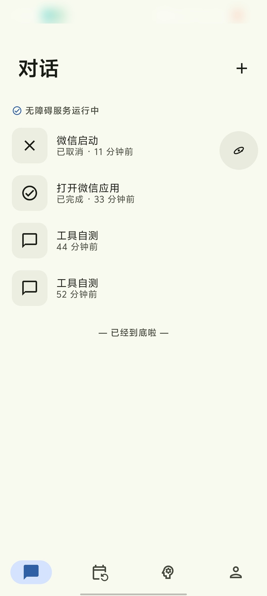<br><sub>Chat list</sub></td>
    <td align="center" valign="top">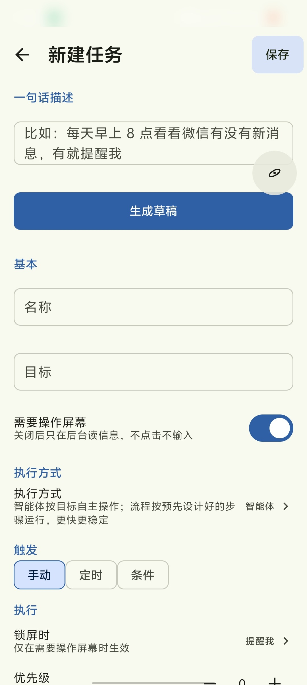<br><sub>New task: describe it in one sentence to get a draft</sub></td>
  </tr>
</table>

### Flows: saving repeated operations

Repeated work can be turned into a **flow** and run directly later, without asking the model to reason it out each time. Flows come from three sources:

1. **AI creation**: describe the flow in natural language. The AI asks questions while it thinks and produces a step draft you can preview.
2. **Floating-ball recording**: switch to the target app and operate it normally. AutoP records the steps and converts them. You can pick elements, set parameters, and test-run the flow.
3. **Agent proposals**: after a successful task, if its interface operations are worth reusing, the agent drafts a flow. It takes effect only after you confirm.

Flow execution checks and recovers from errors. After each action, it verifies the result. On failure, it tries waiting, another position, going back, and restarting the app in turn. If that still fails, it hands control back to the agent.

<table>
  <tr>
    <td align="center" valign="top">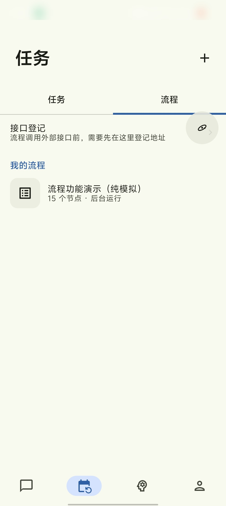<br><sub>My flows</sub></td>
    <td align="center" valign="top">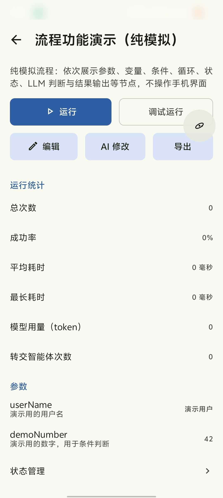<br><sub>Details: run, debug, statistics, and parameters</sub></td>
    <td align="center" valign="top">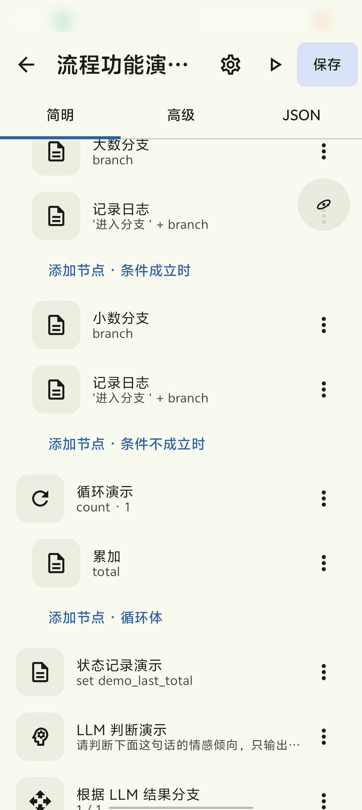<br><sub>Editor: simple / advanced / JSON</sub></td>
  </tr>
</table>

### Memory

A memory tree organized by directory: user profile, people, operation manuals for each app, and task notes. The prompt holds only an index, and the full text is read when needed. Retrieval combines path matching, full-text search (Chinese bigram tokenization), and vector search. The agent can write directly. Every write is versioned, and you can undo changes one by one under "Recent changes".

### Experience while running

- Global floating ball: idle, running, paused, waiting for an answer, and recording each have their own state. Tapping it opens an arc menu and a progress panel.
- **Edge glow while running**: while the agent operates the phone, a soft glow in the theme color flows and breathes around the screen edges. A step counter capsule appears at the top.
- **Touch shield**: blocks accidental touches during a run, including the status bar. It is removed immediately on pause or stop.

### Models

- OpenAI-compatible (chat/completions) and Anthropic-compatible (Messages) protocols, without official SDKs.
- Configure one default model, shared by chat, tasks, and flows. Embedding is configured separately and can be turned off.
- When the context nears its limit, it is compressed automatically. The full event log is kept, and the original text can be recalled when needed.

<table>
  <tr>
    <td align="center" valign="top">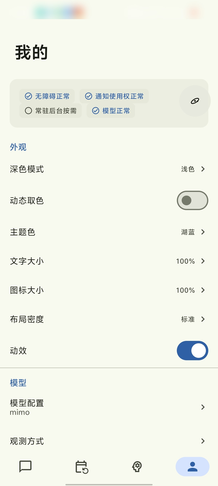<br><sub>Me: appearance, models, observation mode, and other settings</sub></td>
  </tr>
</table>

## How it works

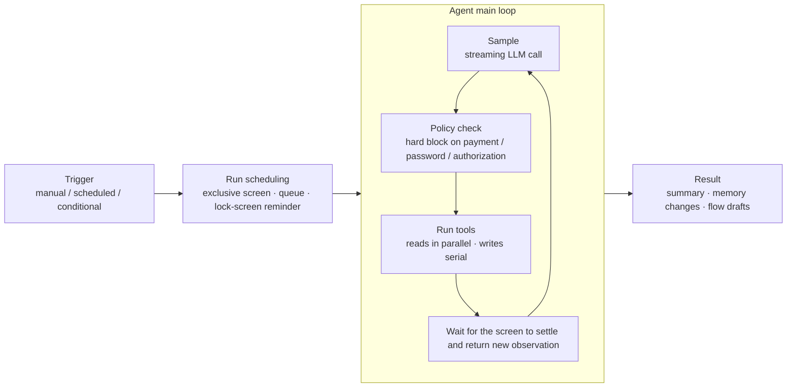

- Read tools run in parallel, and action tools take exclusive use of the screen. If one action in a batch fails, the rest are skipped so the agent does not keep tapping on the wrong screen.
- History is kept in two forms: an append-only full event log, and a compact view sent to the model (old observations are downgraded, long output is truncated, and compression runs when needed).
- When the budget runs out, the agent does not throw an error. It disables tools for the last round so the model can summarize how far it got. A circuit breaker fires when the same tool repeats the same error, or when the screen fingerprint does not change.
- Screen and notification content is always passed to the model as **untrusted data**. The system prompt states that any "instructions" inside it are only data.

**Built-in tools**: observation (`observe` / `screenshot` / `read_notifications` / `get_device_state`), actions (`tap` / `tap_node` / `input_text` / `scroll` / `scroll_node` / `swipe` / `global_action` / `open_app` / `intent` / `wait`), recovery (`restart_app`), memory (`memory_*`), flows (`run_flow` / `list_flows` / `create_flow` / `edit_flow` / `save_as_flow` / `update_flow` / `patch_flow_node`), tasks (`list_tasks` / `create_task` / `update_task`), and collaboration (`ask_user` / `notify_user` / `update_plan` / `finish`, among others).

## Getting started

### Requirements

- JDK 21 (specified in `gradle/gradle-daemon-jvm.properties`)
- Android SDK, compileSdk 37; device running Android 11 (API 30) or later
- No root and no custom ROM needed. The wireless debugging injection channel is optional
- An LLM service: any OpenAI-compatible or Anthropic-compatible endpoint, with its API key

### Build and install

```bash
./gradlew :app:assembleDebug        # Debug build → app/build/outputs/apk/debug/
./gradlew :app:assembleRelease      # Release build
```

Release signing reads `keystore.properties` in the repository root (`storeFile` / `storePassword` / `keyAlias` / `keyPassword`; this file is gitignored). If it is missing, the build produces an unsigned package, and the build still succeeds.

### First run

The app guides you through each step and checks status in real time:

1. **Model configuration** (required): choose a protocol, fill in baseUrl, API key, and model name, then tap "Test connection" to confirm the model is reachable. If the model does not support tool calling, the app switches to the text protocol automatically.
2. **Accessibility service** (required): reads interface nodes, takes screenshots, and detects the foreground app. It is also the source for observation and screenshots, so the agent cannot observe without it. Tap and swipe also have a shell injection channel, but that channel does not replace observation.
   On Android 13 and later, apps sideloaded from outside the store are blocked by "Restricted settings". To allow them: App info → the menu in the top-right corner → Allow restricted settings.
3. **Overlay permission** (recommended): fallback channel for the floating ball and the running indicator.
4. Notification access (needed for notification-based triggers), notification permission, and full-screen intent permission (needed for lock-screen reminders).
5. Battery optimization allowlist and each vendor's auto-start or background-running settings, so the system does not kill scheduled or conditional tasks.
6. **Wireless debugging injection channel** (optional): Settings → Injection channel. After pairing, taps, swipes, and text input can go through shell injection.

## Permissions

| Permission | Purpose |
|---|---|
| Accessibility service | Read interface nodes, perform taps and gestures, take screenshots, detect the foreground app |
| Notification access | Notification-based conditional triggers, reading notifications |
| `SYSTEM_ALERT_WINDOW` | Fallback channel for the floating ball, progress panel, and running indicator |
| `POST_NOTIFICATIONS` | Report task results, lock-screen reminders |
| `SCHEDULE_EXACT_ALARM` | Exact timing for scheduled tasks (falls back to inexact timing without it) |
| `USE_FULL_SCREEN_INTENT` | Show full-screen reminders on the lock screen |
| `FOREGROUND_SERVICE` / `_SPECIAL_USE` | Keep a foreground service running so background-triggered tasks can run |
| `RECEIVE_BOOT_COMPLETED` | Restore scheduled and conditional tasks after reboot |
| `REQUEST_IGNORE_BATTERY_OPTIMIZATIONS` | Prompt the user to join the battery optimization allowlist |
| `INTERNET` / `ACCESS_NETWORK_STATE` | Reach the model endpoint you configured, network-based conditional triggers |

## Privacy and security

- **Screen content is uploaded**: the interface text and screenshots the agent reads are sent to the model service you configure. Network requests go only to the endpoints you set. The project contains no third-party analytics or crash-reporting SDKs. For fully local use, point the endpoint at a model you host yourself.
- **Hard blocks on sensitive screens**: payment, transfer, password, authorization, account deletion, and installing unknown apps are blocked at the execution layer, not by prompt instructions. When one is hit, the task pauses and notifies you to handle it yourself. The rules are updatable data.
- **Hidden apps**: apps you add under "Me → Hidden apps" are neither read nor operated on while they are in the foreground.
- **Keys and logs**: API keys are stored encrypted with Android Keystore. Password field content is excluded from observation and logs, and logs do not record keys or full screenshots.
- **Action log**: every action is written to the action log, viewable under "Me → Action log", for review after the fact.
- While running, the agent fully trusts your instructions by default. Be careful with irreversible actions such as "who to message and what to send".

## Project structure

The codebase is split into Gradle modules by business domain. Modules communicate only through `-api` modules. The build scripts enforce the dependency rules, and a violation fails the build.

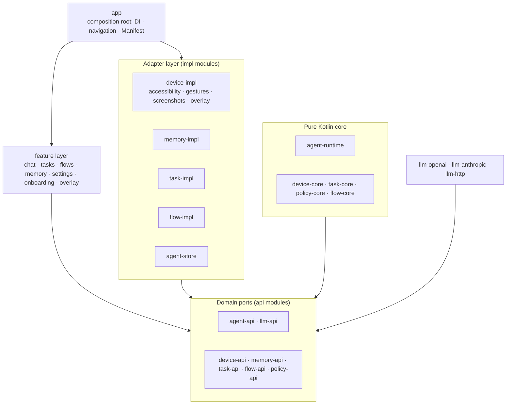

| Group | Modules | Description |
|---|---|---|
| `core/` | `core-common` `core-config(-impl)` `core-prompt(-impl)` `core-platform` `core-ui` `core-testing` | Base types, layered configuration, prompt templates, platform adapters and keys, design system |
| `llm/` | `llm-api` `llm-http` `llm-openai` `llm-anthropic` `llm-onnx` | Unified message model and adapters for both protocols, SSE, retries; on-device ONNX embedding |
| `agent/` | `agent-api` `agent-runtime` `agent-store` | Tool SPI, main loop, compression, circuit breaker, event log storage |
| `domain/` | `device-*` `memory-*` `task-*` `flow-*` `policy-*` | Device perception and execution, memory, tasks and triggers, flows, safety policy |
| `feature/` | `feature-chat` `-tasks` `-flows` `-memory` `-settings` `-onboarding` `-overlay` | Pages and overlays. They do not depend on each other and are connected by the app's navigation graph |
| `app/` | `app` | Dependency injection bindings, navigation, Manifest |

Each module's root directory has a `README.md` that describes its role, its external interface, and how to extend it.

## Development guide

### Conventions

- The pure Kotlin domain layer does not import `android.*`. When it needs Android capabilities, it defines a port in its `-api` module, and an `-impl` module implements it.
- **No hardcoding**: thresholds, timeouts, and retry counts go into configuration (`assets/config/*.json`; Kotlin defaults are only fallbacks, and tests ensure both agree). Prompts and tool descriptions go into `assets/prompts/**/*.md`. Third-party app package names and interface keywords go into `assets/rules/*.json`. User-facing text goes into `strings.xml`.
- New capabilities use extension points: implement an interface, give it a stable string `id`, and register it in your module's DI. Do not change branching logic in the core. Tools (`Tool`), model protocols, trigger sources, condition checks, policy rules, and retrieval channels all follow this pattern.
- Changes to persisted formats must include a version and a migration. Room `Migration`s need migration tests. Configuration, rules, and the event log all carry a `schemaVersion` or `version`.
- Coroutines are cancellable, and `CancellationException` is never swallowed. Errors use error-code constants, and tool errors include a `hint` for the model.

### Checks before committing

```bash
./gradlew ktlintFormat
./gradlew ktlintCheck detekt test testDebugUnitTest :app:assembleDebug
```

Tests cover the core and the adapter layer. The agent's main loop is tested with a scripted fake model and fake device, to verify tool call order, compression, circuit breaking, and cancellation. Both protocol adapters run the same contract tests against recorded SSE fixtures. Node-tree serialization is tested with snapshots captured on a real device. Room has migration tests. The project has more than a thousand unit tests. End-to-end evaluation requires a real device.

### Commit conventions

Conventional Commits, with the scope set to the module or domain name, for example `feat(memory): …` or `fix(device): …`. Branches are named `feat/<summary>` or `fix/<summary>`. Do not commit directly to `main`.

## Third-party dependencies and licenses

The tables below list the open-source libraries the project uses directly. Versions come from `gradle/libs.versions.toml`. License information comes from each project's public statements and is provided for reference only. Check each project's original license before redistribution or commercial use.

**Runtime dependencies (included in the APK)**

| Library | Version | License | Purpose |
|---|---|---|---|
| [Kotlin](https://github.com/JetBrains/kotlin) / kotlinx.coroutines / kotlinx.serialization | 2.2.10 / 1.11.0 / 1.11.0 | Apache-2.0 | Language, coroutines, JSON serialization |
| [Jetpack Compose](https://developer.android.com/jetpack/compose) (BOM 2026.09.00) | 2026.09.00 | Apache-2.0 | UI: ui, foundation, material3, material-icons-extended |
| [AndroidX](https://developer.android.com/jetpack/androidx): core-ktx 1.19.1, activity-compose 1.13.0, lifecycle 2.11.0, navigation 2.10.2, savedstate 1.5.0 | See left | Apache-2.0 | Base components, lifecycle, navigation |
| AndroidX: room 2.8.5, sqlite 2.6.2, datastore 1.2.1, work 2.12.0 | See left | Apache-2.0 | Local database (Room with the KSP compiler), key-value settings, background work |
| [Dagger / Hilt](https://github.com/google/dagger) (hilt-android, hilt-navigation-compose 1.4.0) | 2.60.1 | Apache-2.0 | Dependency injection |
| [OkHttp](https://github.com/square/okhttp) 5.5.0 | 5.5.0 | Apache-2.0 | HTTP and SSE connections |
| [javax.inject](https://github.com/google/guice) | 1 | Apache-2.0 | Injection annotations |
| [ONNX Runtime Android](https://github.com/microsoft/onnxruntime) | 1.29.0 | MIT | Inference for the on-device vision and embedding models |
| [Bouncy Castle](https://www.bouncycastle.org/) (bcpkix-jdk18on) | 1.80 | Bouncy Castle License (MIT-style) | Certificate and key handling for wireless debugging pairing |
| [Conscrypt](https://github.com/google/conscrypt) | 2.5.2 | Apache-2.0 | TLS implementation for wireless debugging |
| [BoringSSL (NDK prebuilt)](https://github.com/google/boringssl) | 20250114 | OpenSSL / ISC-style license | Native implementation for SPAKE2 pairing in wireless debugging |

**Build, test, and quality tools (not included in the APK)**

| Library | Version | License | Purpose |
|---|---|---|---|
| [Android Gradle Plugin](https://developer.android.com/build) | 9.4.0 | Apache-2.0 | Android build |
| [KSP](https://github.com/google/ksp) | 2.2.10-2.0.2 | Apache-2.0 | Annotation processing |
| [detekt](https://github.com/detekt/detekt) | 1.23.8 | Apache-2.0 | Static analysis |
| [ktlint](https://github.com/pinterest/ktlint) (ktlint-gradle plugin) | 14.2.0 | MIT | Code style checks |
| [Kover](https://github.com/Kotlin/kotlinx-kover) | 0.9.11 | Apache-2.0 | Coverage measurement |
| [JUnit 4](https://github.com/junit-team/junit4) | 4.13.2 | EPL-1.0 | Unit tests |
| [Robolectric](https://github.com/robolectric/robolectric) | 4.17 | MIT | Android tests on the JVM |
| [Truth](https://github.com/google/truth) | 1.4.5 | Apache-2.0 | Assertions |
| [Turbine](https://github.com/cashapp/turbine) | 1.2.1 | Apache-2.0 | Flow testing |
| AndroidX Test (core 1.7.0, junit 1.3.0), Espresso 3.7.0 | See left | Apache-2.0 | Android instrumentation tests |

**Code adapted from other open-source projects**

- **[Shizuku](https://github.com/RikkaApps/Shizuku)** (Apache-2.0, copyright RikkaApps): the ADB injection channel adapts Shizuku's ADB protocol stack (`domain/device-impl/.../impl/adb/`, including AdbClient, AdbProtocol, AdbMessage, AdbKey, AdbMdns, and AdbPairingClient), and the native code for SPAKE2 wireless debugging pairing (`libadb.so` from Shizuku's `jni/`, which depends on the BoringSSL prefab). The adapted files keep their original source and license header comments. Only debug logging was removed. Using this code requires compliance with the Apache License 2.0.

**Model weights bundled in the APK**

| File | Purpose | Source | License |
|---|---|---|---|
| `gui_detect.onnx` | Control box detection (YOLO, single class: icon) | Starts from Ultralytics YOLO11s (COCO pretrained), fine-tuned on YOLO labels that MobileViews-derived data was converted into from view hierarchies (`yolo_v2`, `tools/vh2yolo_v2.py`). Training run `poc/visual-parsing/runs/vp8_B2`, exported by `tools/export_vp8_assets.py`. The ONNX metadata names "Ultralytics YOLO11s" | AGPL-3.0 (Ultralytics). Ultralytics' official answer: without an Enterprise License, using these weights under AGPL-3.0 requires open-sourcing the entire solution, including the weights |
| `ocr_det.onnx` | Text line detection (PP-OCRv5 mobile, DB) | PaddleOCR PP-OCRv5 mobile detection model, converted with paddle2onnx (`poc/visual-parsing/out/v5`) | Apache-2.0 (PaddleOCR) |
| `ocr_rec_server.onnx` | Text recognition (PP-OCRv5 server recognition model, quantized) | PaddleOCR PP-OCRv5 server recognition model (`poc/visual-parsing/weights/PP-OCRv5_server_rec_infer.tar`) | Apache-2.0 (PaddleOCR) |
| `ppocr_keys.txt` | Text recognition character dictionary | Exported from the `character_dict` in the PP-OCRv5 recognition model's `inference.yml` | Apache-2.0 (PaddleOCR) |
| `ocr_lexicon.txt` | OCR lexicon (UI vocabulary for CTC lexicon rescoring) | Chinese UI vocabulary compiled by the project, see `docs/design/ocr-accuracy-uplift.md` | Part of this repository (project-owned content) |
| `icon_cls.onnx` | Icon classification (MobileNetV3-Small, 102 classes) | torchvision MobileNetV3-Small (ImageNet pretrained) with a 102-class head, trained on icon-dataset (boostvolt/icon-dataset, 100 classes) plus two rejection classes (text_crop, image_crop), `poc/visual-parsing/tools/train_icon_cls.py` | Code and pretrained weights: BSD-3-Clause (torchvision). icon-dataset declares no license (none in its README or file list) |
| `state_cls.onnx` | Toggle state classification (MobileNetV3-Small, shared by checkbox / radio / switch) | torchvision MobileNetV3-Small (ImageNet pretrained), trained on control crops derived from MobileViews, with labels from the VH `checked` attribute, `tools/build_state_crops.py`, `tools/train_state_cls.py` | Code and pretrained weights: BSD-3-Clause (torchvision). Training data see below |

MobileViews (mllmTeam, a Hugging Face dataset) is the data source for `yolo_v2` and `state_cls`. The design document (`docs/design/visual-screen-parsing.md`) records it as copyright:none. Its license field on the dataset page could not be verified.
| `llm/llm-onnx/.../embedding/bge-small-zh-v1.5-int8/` | Chinese text embedding (int8 quantized) | [BAAI/bge-small-zh-v1.5](https://huggingface.co/BAAI/bge-small-zh-v1.5), ONNX version converted by onnx-community | MIT |

## CI and release

Pushes to `main`, `v*` tags, or manual runs of `.github/workflows/release.yml` run the quality gates (test, detekt, ktlint), build the release APK, and upload it as an artifact (**the final APK only**). When a `v*` tag is pushed, the APK is also published to the matching [GitHub Release](https://github.com/W1412X/autop/releases).

Signing uses repository secrets: `ANDROID_KEYSTORE_BASE64` (the keystore as base64), `ANDROID_KEYSTORE_PASSWORD`, `ANDROID_KEY_ALIAS`, and `ANDROID_KEY_PASSWORD`. If they are missing, the build falls back to an unsigned package and prints a warning.

## Download

Download the latest `app-release.apk` from [GitHub Releases](https://github.com/W1412X/autop/releases). To sideload on Android 13 or later, first allow restricted settings in the app info page, then enable the accessibility service. See [First run](#first-run).

## License

For development and learning only. The repository does not currently declare a license. Contact the author before using or modifying the code.
