# AutoP

[](https://github.com/W1412X/autop/actions/workflows/release.yml)


**跑在手机上的通用操作 Agent。** 你用一句话下达任务，AutoP 通过无障碍服务读屏、操作，由大模型规划每一步，替你完成点、滑、输入、跨应用的事。

它不为任何具体 App 写专门的代码路径：应用相关的知识（操作手册、敏感页面规则）都是可编辑的数据，Agent 在使用中不断补充。

> 这是一个自用项目，不上架应用商店。运行时屏幕内容会发送到**你自己配置的**模型服务，使用前请先阅读[隐私与安全](#隐私与安全)。

<table>
  <tr>
    <td align="center" valign="top">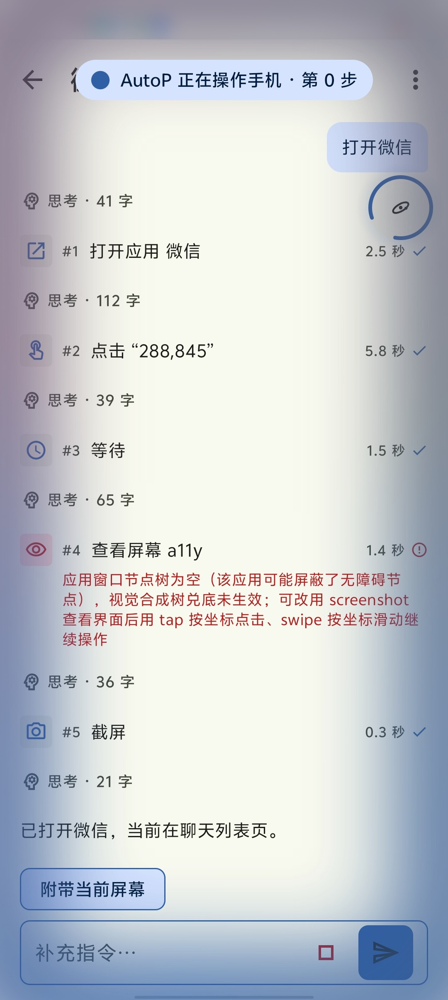<br><sub>对话：每一步都可展开查看</sub></td>
    <td align="center" valign="top">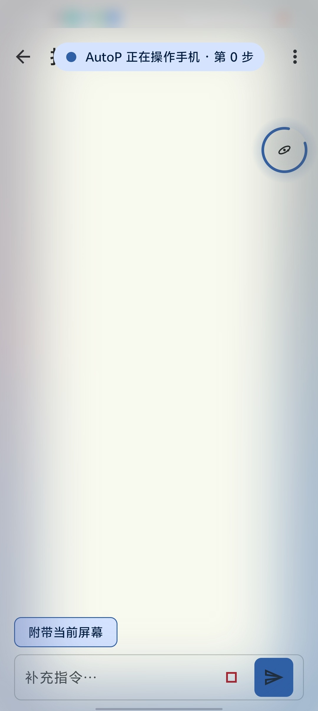<br><sub>执行期：边缘光 + 步数胶囊</sub></td>
    <td align="center" valign="top">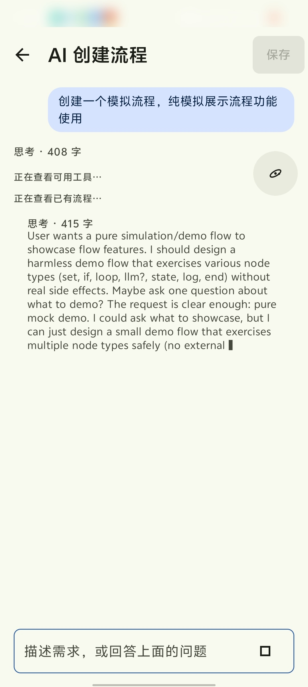<br><sub>AI 创建流程：边思考边生成</sub></td>
    <td align="center" valign="top">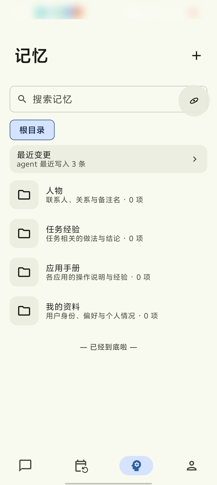<br><sub>记忆：按目录组织</sub></td>
  </tr>
</table>

## 目录

- [能做什么](#能做什么)
- [工作原理](#工作原理)
- [快速开始](#快速开始)
- [权限说明](#权限说明)
- [隐私与安全](#隐私与安全)
- [项目结构](#项目结构)
- [开发指南](#开发指南)
- [CI 与发布](#ci-与发布)
- [下载安装包](#下载安装包)

## 能做什么

### 一句话让手机自己干活

在对话页或悬浮球里下达任务，例如「把屏幕亮度调到 50%」「微信里告诉张三明天的会推迟到 4 点」。Agent 会列出计划、逐步操作，每一步都能在时间线里展开查看动作、观测和耗时。运行中可以随时补充指令（不打断当前动作），也可以一键停止。

### 三种方式看懂屏幕，按需自动切换

| 观测模式 | 来源 | 适用 |
|---|---|---|
| `a11y` | 无障碍节点树，精简序列化为带短 ID 的文本 | 默认，成本最低 |
| `visual` | 截图 + 端侧 ONNX 模型（目标检测、OCR、图标分类） | 应用屏蔽了节点信息 |
| `llm` | 截图交给视觉大模型识别元素 | 前两者都不够时 |

三种模式输出同一种 0–1000 归一化坐标，所以操作层不关心画面从哪里来。节点树为空、WebView、游戏这类场景会自动降级。

### 稳地点、稳地滑

- **节点动作优先**：观测和行动都来自无障碍时，点击、长按、滚动优先走系统的无障碍节点动作；被应用拒绝时回落为坐标手势。
- **按应用记忆**：发现某个应用接受节点动作却不响应（节点无效而手势有效），累计证据后自动记录，之后对它直接使用手势。可在「我的 → 节点操作」查看和恢复。
- **滚动按容器算距离**：一步相当于人手滑一下，起止点落在可滚动区域内，避免越界导致无效；到头会明确告诉模型。
- **等待界面稳定**：每个动作后等待页面静默再返回新观测，无需模型反复调用观察。
- **可选的注入通道**：通过无线调试配对，使用 shell 注入点击与按键，对会丢弃无障碍注入事件的应用更稳。

### 任务与触发

| 触发 | 说明 |
|---|---|
| 手动 | 对话、悬浮球、任务页「立即运行」 |
| 定时 | 一次性或重复（每天、工作日…），精确闹钟，无权限时降级 |
| 条件 | 通知到达、App 进入前台、充电状态、网络变化、解锁，可叠加规则过滤与大模型判定 |

条件触发有冷却期、每日上限和重复事件去重，避免被消息风暴反复触发。需要屏幕但手机锁屏时，会发闹钟级提醒，解锁后一键执行或稍后再说。

<table>
  <tr>
    <td align="center" valign="top">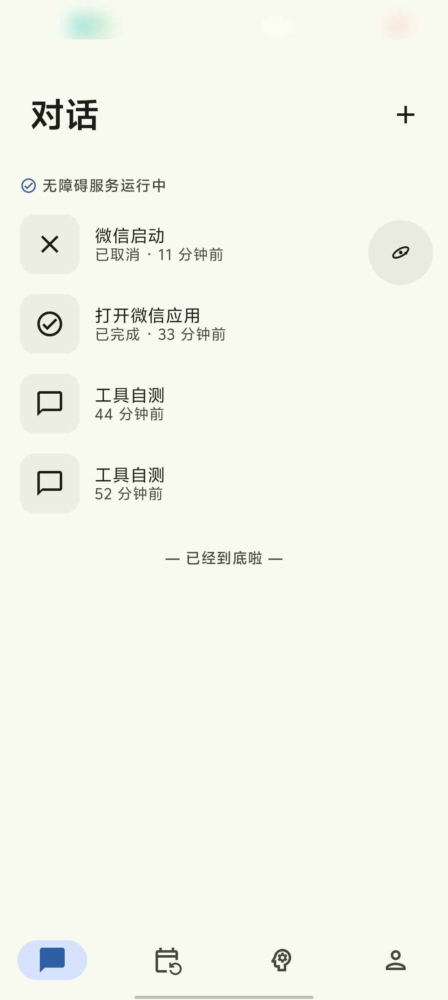<br><sub>对话列表</sub></td>
    <td align="center" valign="top">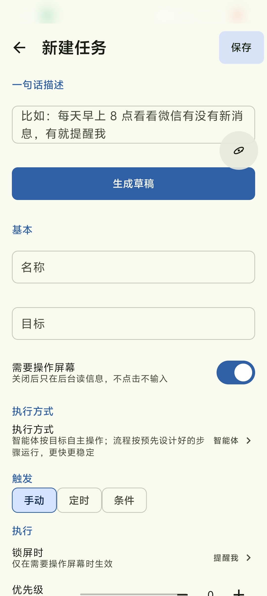<br><sub>新建任务：一句话描述，生成草稿</sub></td>
  </tr>
</table>

### 流程：把重复操作沉淀下来

重复做的事可以固化成**流程**，之后直接运行，不必每次让模型重新推理。流程有三个来源：

1. **AI 创建**：用自然语言描述，AI 边思考边提问，生成可预览的步骤草稿。
2. **悬浮球录制**：切到目标应用正常操作，AutoP 记录并转成步骤；可拾取元素、设置参数、试运行。
3. **Agent 自动提议**：任务成功后，如果其中的界面操作值得复用，Agent 生成草稿，等你确认后才生效。

流程执行带校验与恢复：动作后核对结果，失败时依次尝试等待、换位置、关闭弹窗、返回、重启应用，仍不行再交回 Agent 接手。

<table>
  <tr>
    <td align="center" valign="top">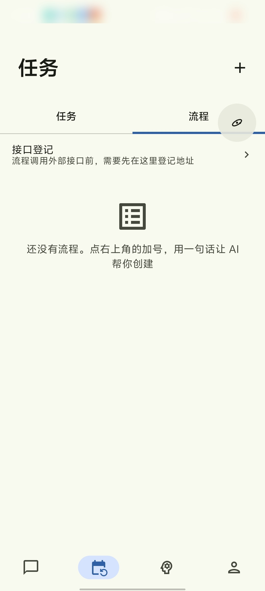<br><sub>流程页：点右上角加号创建</sub></td>
    <td align="center" valign="top">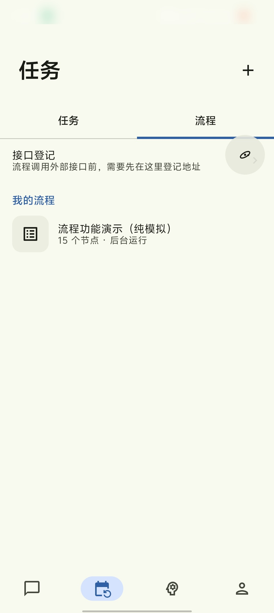<br><sub>我的流程</sub></td>
    <td align="center" valign="top">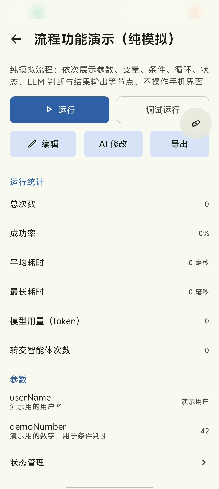<br><sub>详情：运行、调试、统计与参数</sub></td>
    <td align="center" valign="top">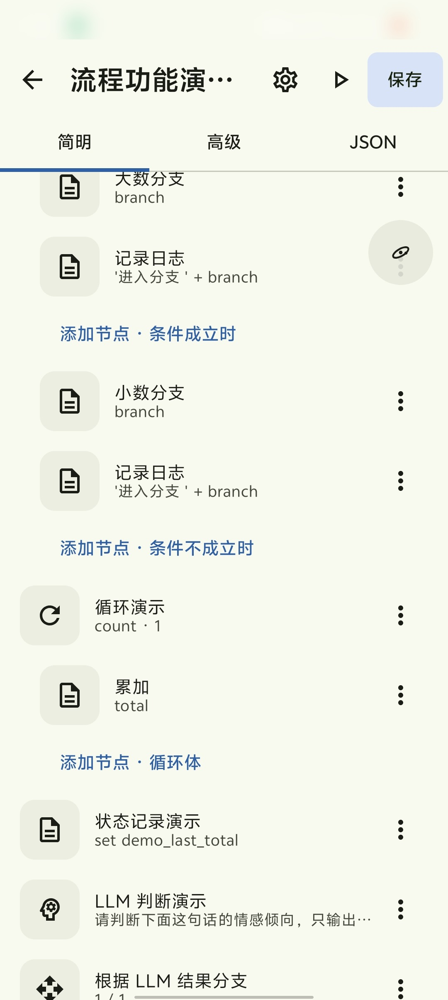<br><sub>编辑器：简明 / 高级 / JSON</sub></td>
  </tr>
</table>

### 记忆

按目录组织的记忆树（用户档案、人物、各 App 的操作手册、任务笔记）。提示词里只放索引，正文按需读取；检索是路径匹配、全文（中文二元组分词）和向量的混合召回。Agent 可以直接写入，所有写入带版本，可在「最近变更」里逐条撤销。


### 执行期体验

- 全局悬浮球：空闲、运行、暂停、等待回答、录制各有状态，点开是圆弧菜单与进度面板。
- **执行期边缘光**：Agent 操作手机时，屏幕四周有随主题色流动、呼吸的柔光，顶部显示步数胶囊。
- **触摸盾**：执行期间屏蔽用户误触（含状态栏），暂停或停止后立即解除。


### 模型

- OpenAI 兼容（chat/completions）与 Anthropic 兼容（Messages）两种协议，不依赖官方 SDK。
- 可按角色分配：主模型、视觉模型、轻量模型（条件判定、经验提炼、压缩摘要）。Embedding 独立配置，可关闭。
- 上下文接近上限时自动压缩，完整事件日志保留，需要时可回取原文。

<table>
  <tr>
    <td align="center" valign="top">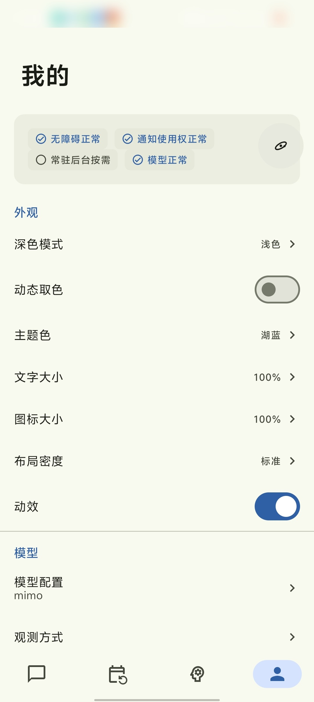<br><sub>「我的」：外观、模型、观测方式等设置</sub></td>
  </tr>
</table>

## 工作原理

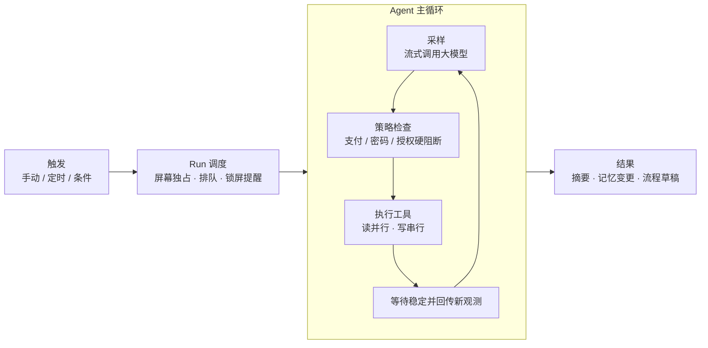

- 读工具并行、动作工具独占屏幕；一批动作中前一个失败，后面的会跳过，避免在错误的屏幕上继续点。
- 历史分两份：追加式的完整事件日志，和发给模型的精简视图（旧观测降级、长输出截断、必要时压缩）。
- 预算触顶不抛错，而是最后一轮禁用工具，让模型总结做到了哪一步。同一工具同一错误连续出现、屏幕指纹原地不变，会触发熔断提示。
- 屏幕与通知内容一律作为**不可信数据**交给模型，系统提示明确声明其中的「指令」只是数据。

**内置工具**：观察（`observe` / `screenshot` / `read_notifications` / `get_device_state`）、动作（`tap` / `input_text` / `scroll` / `swipe` / `global_action` / `open_app` / `open_uri` / `wait`）、恢复（`dismiss_popup` / `restart_app`）、记忆（`memory_*`）、流程（`run_flow` / `list_flows` / `save_as_flow` / `update_flow`）、协作（`ask_user` / `notify_user` / `update_plan` / `finish` 等）。

## 快速开始

### 环境

- JDK 21（`gradle/gradle-daemon-jvm.properties` 指定）
- Android SDK，compileSdk 37；设备 Android 11（API 30）及以上
- 大模型服务：任意 OpenAI 兼容或 Anthropic 兼容端点，以及对应的 API Key

### 构建与安装

```bash
./gradlew :app:assembleDebug        # Debug 包 → app/build/outputs/apk/debug/
./gradlew :app:assembleRelease      # Release 包
```

Release 签名读取仓库根目录的 `keystore.properties`（`storeFile` / `storePassword` / `keyAlias` / `keyPassword`，已 gitignore）。缺少该文件时产物为未签名包，不影响构建。

### 首次使用

应用内有逐项引导并实时检测状态：

1. **模型配置**（必需）：选择协议，填写 baseUrl、API Key、模型名，点「测试连接」，会自动探测工具调用与视觉能力。
2. **无障碍服务**（必需）：没有它 Agent 既看不到屏幕也不能操作。
   Android 13+ 侧载安装的应用会被「受限设置」拦截：应用信息 → 右上角菜单 → 允许受限设置。
3. **悬浮窗权限**（推荐）：悬浮球与执行期指示的备用通道。
4. 通知使用权（条件触发需要）、通知权限、全屏提醒权限（锁屏提醒需要）。
5. 电池优化白名单与各厂商的自启动 / 后台运行设置，保证定时与条件任务不被系统杀掉。
6. **无线调试注入通道**（可选）：设置 → 注入通道，配对后点击与按键走 shell 注入。

## 权限说明

| 权限 | 用途 |
|---|---|
| 无障碍服务 | 读取界面节点、执行点击与手势、截图、检测前台应用 |
| 通知使用权 | 通知类条件触发、读取通知 |
| `SYSTEM_ALERT_WINDOW` | 悬浮球、进度面板、执行期指示的备用通道 |
| `POST_NOTIFICATIONS` | 汇报任务结果、锁屏提醒 |
| `SCHEDULE_EXACT_ALARM` | 定时任务精确触发（无权限时降级为不准时） |
| `USE_FULL_SCREEN_INTENT` | 锁屏时弹出全屏提醒 |
| `FOREGROUND_SERVICE` / `_SPECIAL_USE` | 前台服务常驻，保证后台触发的任务能跑 |
| `RECEIVE_BOOT_COMPLETED` | 开机后恢复定时与条件任务 |
| `REQUEST_IGNORE_BATTERY_OPTIMIZATIONS` | 引导加入电池优化白名单 |
| `INTERNET` / `ACCESS_NETWORK_STATE` | 访问你配置的模型端点、网络类条件触发 |

## 隐私与安全

- **屏幕内容会上传**：Agent 读到的界面文本和截图会发给你配置的模型服务。网络请求只发往你配置的端点；项目不含统计、崩溃上报等第三方数据上报 SDK。想要完全本地，可以把端点指向自己部署的模型。
- **敏感场景硬阻断**：支付、转账、密码、授权、删除账号、安装未知应用等场景在执行层拦截（不依赖提示词），命中后暂停任务并通知你手动处理。规则是可更新的数据。
- **屏蔽应用**：在「我的 → 屏蔽的应用」里加入的应用，前台时 Agent 不读屏、不操作。
- **密钥与日志**：API Key 经 Android Keystore 加密存放；密码框内容不进入观测与日志，日志里不记录密钥与完整截图。
- **操作记录**：所有动作写入操作记录，可在「我的 → 操作记录」查看，便于事后排查。
- 运行中 Agent 默认完全信任你的指令；请对「发消息给谁、发什么」这类不可撤销的操作保持谨慎。

## 项目结构

按业务领域拆 Gradle 模块，模块之间只通过 `-api` 通信，依赖规则由构建脚本强制检查（违反则构建失败）。

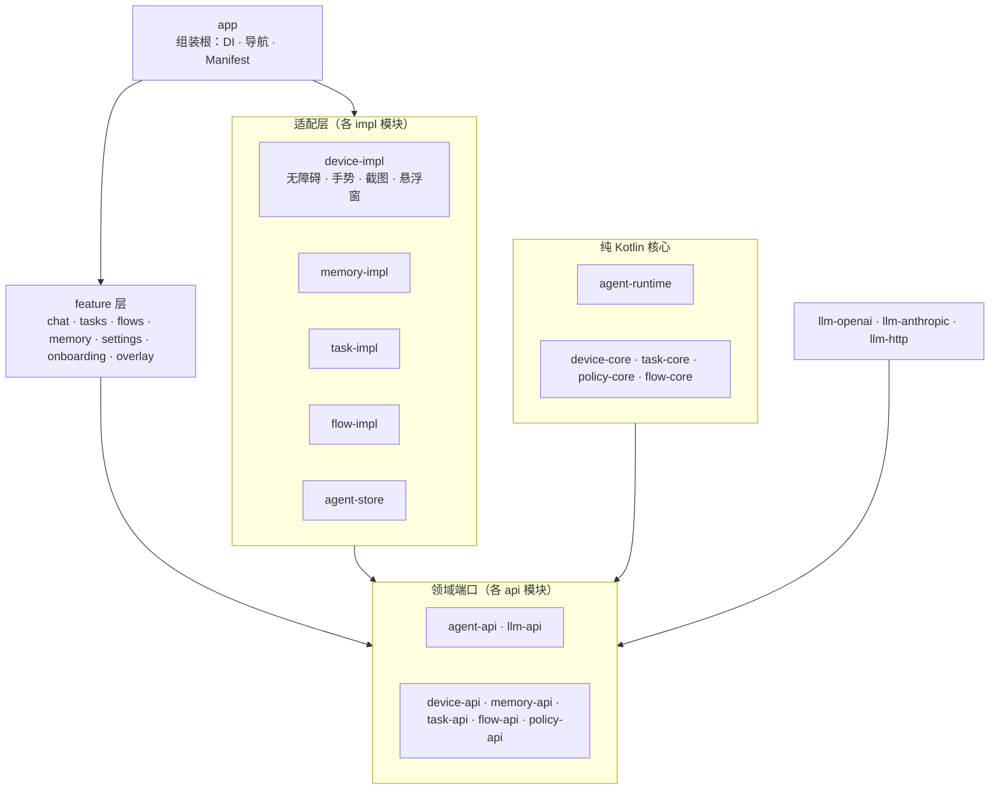

| 分组 | 模块 | 说明 |
|---|---|---|
| `core/` | `core-common` `core-config(-impl)` `core-prompt(-impl)` `core-platform` `core-ui` `core-testing` | 基础类型、分层配置、提示词模板、平台适配与密钥、设计系统 |
| `llm/` | `llm-api` `llm-http` `llm-openai` `llm-anthropic` | 统一消息模型与两种协议适配器、SSE、重试 |
| `agent/` | `agent-api` `agent-runtime` `agent-store` | 工具 SPI、主循环、压缩、熔断、事件日志存储 |
| `domain/` | `device-*` `memory-*` `task-*` `flow-*` `policy-*` | 设备感知与执行、记忆、任务与触发、流程、安全策略 |
| `feature/` | `feature-chat` `-tasks` `-flows` `-memory` `-settings` `-onboarding` `-overlay` | 各页面与悬浮层，互不依赖，由 app 的导航图串起来 |
| `app/` | `app` | 依赖注入绑定、导航、Manifest |

各模块根目录都有 `README.md`，说明职责、对外接口和扩展方式。

## 开发指南

### 约定

- 纯 Kotlin 的领域层不引入 `android.*`，需要 Android 能力时在 `-api` 里定义端口，由 `-impl` 实现。
- **不硬编码**：阈值、超时、重试次数进配置（`assets/config/*.json`，Kotlin 默认值只是兜底，有测试保证两者一致）；提示词与工具描述进 `assets/prompts/**/*.md`；第三方应用包名、界面关键词进 `assets/rules/*.json`；用户可见文案进 `strings.xml`。
- 新增能力用扩展点：实现接口、起稳定的字符串 `id`、在自己模块的 DI 里注册，不修改核心里的分支逻辑。工具（`Tool`）、模型协议、触发源、条件判定、策略规则、检索通道等都是这个模式。
- 持久化格式变化必须带版本和迁移：Room `Migration` 加迁移测试，配置、规则、事件日志都有 `schemaVersion` / `version`。
- 协程可取消，`CancellationException` 不被吞；错误用错误码常量，工具错误附给模型看的 `hint`。

### 提交前检查

```bash
./gradlew ktlintFormat
./gradlew ktlintCheck detekt test testDebugUnitTest :app:assembleDebug
```

测试覆盖核心与适配层：Agent 主循环用脚本化的假模型与假设备验证工具调用顺序、压缩、熔断和取消；两种协议适配器用录制的 SSE 夹具跑同一组契约测试；节点树序列化用真机采集的快照做夹具测试；Room 有迁移测试。目前有上千条单元测试，端到端评测需要真机。

### 提交规范

Conventional Commits，scope 用模块领域名，例如 `feat(memory): …`、`fix(device): …`；分支用 `feat/<简述>`、`fix/<简述>`，不直接提交到 `main`。

## CI 与发布

push 到 `main`、打 `v*` tag 或手动触发 `.github/workflows/release.yml`：质量门禁（test / detekt / ktlint）→ 构建 release APK → 上传 artifact（**只含最终 APK**）。打 `v*` tag 时，还会把 APK 发布到该 tag 对应的 [GitHub Release](https://github.com/W1412X/autop/releases)。

签名靠仓库 Secrets：`ANDROID_KEYSTORE_BASE64`（keystore 的 base64）、`ANDROID_KEYSTORE_PASSWORD`、`ANDROID_KEY_ALIAS`、`ANDROID_KEY_PASSWORD`；缺失时降级为未签名包并告警。

## 下载安装包

统一在 [GitHub Releases](https://github.com/W1412X/autop/releases) 下载最新的 `app-release.apk`。侧载安装时，Android 13 及以上需要先在应用信息里「允许受限设置」，再开启无障碍服务，详见[首次使用](#首次使用)。
## 许可

仓库目前没有声明许可证，保留所有权利。如需使用或二次开发，请先联系作者。
