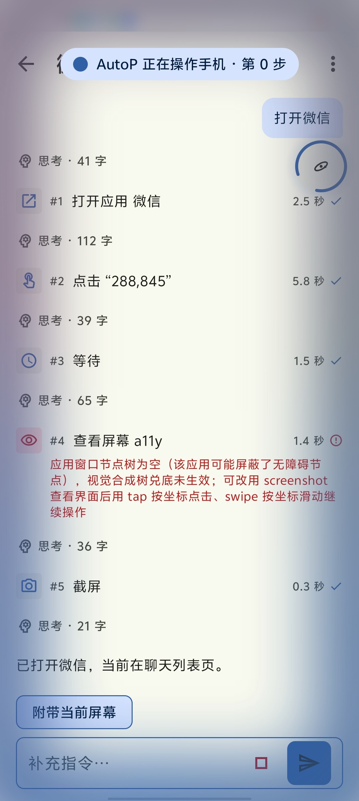
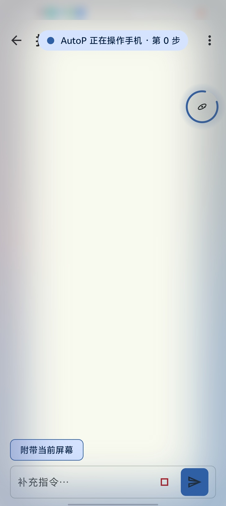
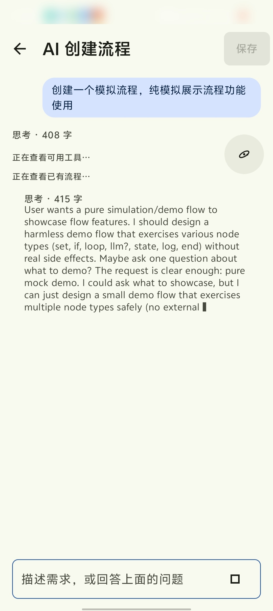
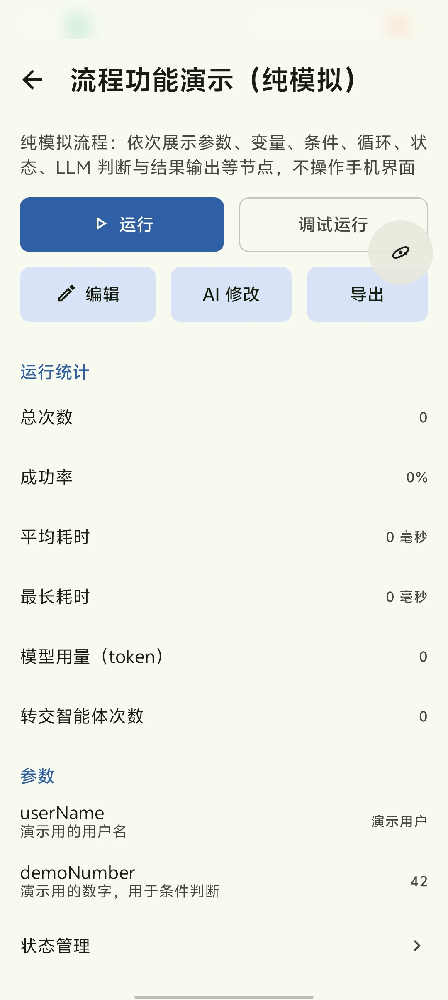
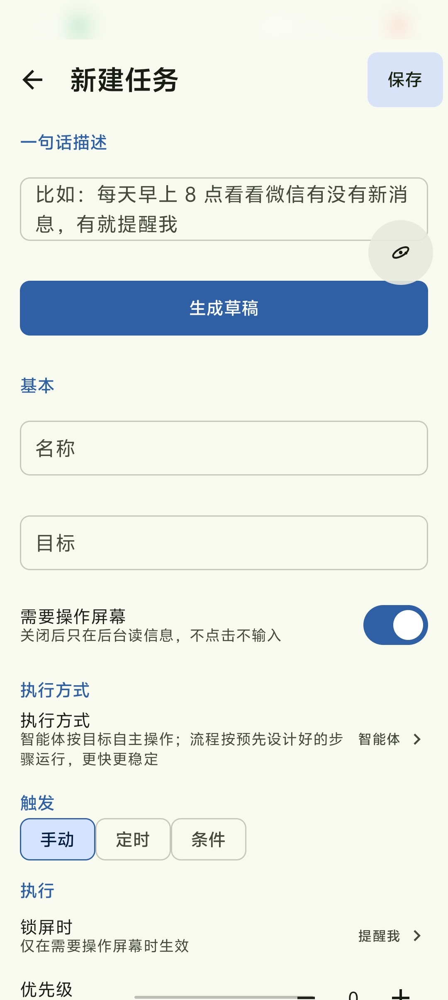
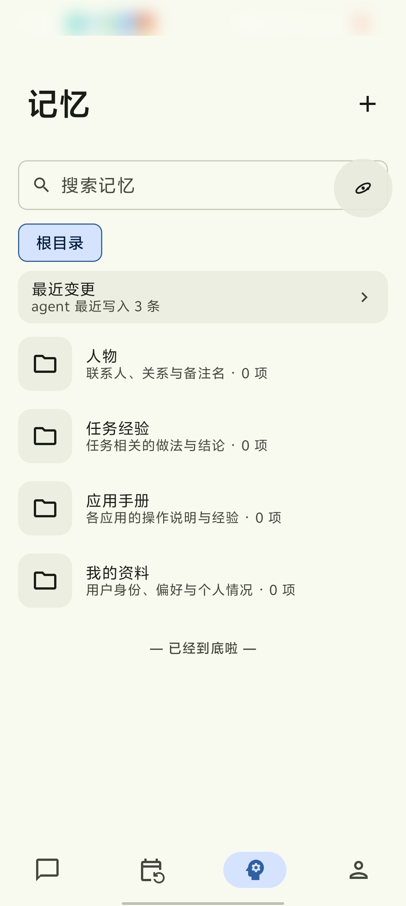
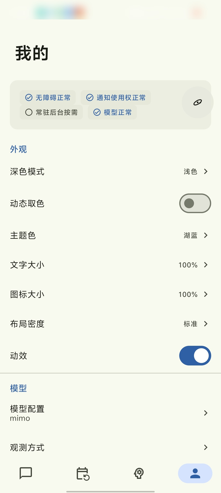

# AutoP：用一句话让手机自己操作自己

AutoP 是一个 Android 应用。你告诉它要做什么，它读屏幕、点按钮、输入文字，直到做完。

- 项目地址：<https://github.com/W1412X/autop>
- 安装包：<https://github.com/W1412X/autop/releases>

这是自用项目，不上架应用商店。需要 Android 11 及以上。

## 它怎么做事

AutoP 通过无障碍服务读取屏幕、执行操作，由你自己配置的大模型决定每一步。循环是这样的：

1. 读取当前屏幕，整理成带编号的文本
2. 模型根据文本选择动作，比如"点击 12 号"
3. 执行动作，等界面稳定
4. 重新读屏，回到第 1 步，直到任务完成

每一步都记在时间线里，点开可以看动作、看到的内容和耗时。运行中可以补充指令，也可以随时停止。

执行时屏幕四周有一圈柔光，顶部显示步数。这段时间会屏蔽用户触摸，避免误触打乱操作，停止或暂停后立即解除。

## 功能

### 三种读屏方式

默认读无障碍节点树，成本最低。有些应用不提供节点信息，这时改用截图：先用端侧的检测和文字识别模型，不够再交给视觉大模型。三种方式输出同一套坐标，后面的操作层不区分来源。

### 点击和滚动

点击、长按、滚动优先使用系统的节点动作，被应用拒绝时改用坐标手势。如果发现某个应用接受节点动作却没有反应，会把它记下来，之后对该应用直接用手势。滚动按可滚动区域计算距离，到底时会告诉模型。

### 流程

重复的操作可以存成流程，之后直接运行，不用每次让模型重新推理。创建方式有三种：

- 用自然语言描述，由 AI 生成
- 打开悬浮球，在手机上操作一遍，自动录制
- 任务成功后，由 Agent 提议保存，确认后生效

流程运行时会校验每一步的结果，失败后依次尝试等待、换位置、关弹窗、返回、重启应用，还不行就交回 Agent。

### 定时和条件触发

支持定时（一次或重复）和条件触发（收到通知、应用进入前台、充电、网络变化、解锁）。条件任务有冷却期、每日上限和重复事件去重。手机锁屏时不会强行执行，而是发一条闹钟级提醒，解锁后点一下再开始。

### 记忆

记忆按目录组织：个人偏好、联系人、各应用的操作经验。提示词里只放目录索引，正文需要时再读取。Agent 可以直接写入，每次写入都有版本，可以逐条撤销。

### 对话

对话里可以发图片，所以也能当普通的 AI 助手用，不限于操作手机。

### 模型

支持 OpenAI 兼容和 Anthropic 兼容两种协议。可以分别指定主模型、视觉模型和轻量模型（用于条件判定、压缩摘要等）。

## 安全和隐私

- 支付、转账、输入密码、授权、删除账号这类场景，在执行层直接拦截，不依赖提示词。命中后任务暂停，通知用户手动处理。
- 屏幕和通知的内容对模型一律按"不可信数据"处理，其中出现的指令只当作普通文字。
- 屏幕内容会发送到你配置的模型服务。项目没有统计或上报类 SDK，请求只发往你填写的地址，也可以指向自己部署的模型。
- API Key 用 Android Keystore 加密保存，密码框内容不进入观测和日志。
- 可以把某些应用加入屏蔽列表，它们在前台时 AutoP 不读屏也不操作。

## 安装

1. 在 [Releases](https://github.com/W1412X/autop/releases) 下载最新的 apk 并安装
2. 填写模型服务的地址、Key 和模型名，点"测试连接"
3. 开启无障碍服务。Android 13 及以上，侧载的应用需要先在应用信息页右上角选"允许受限设置"
4. 建议开启悬浮窗权限，并加入电池优化白名单，否则定时任务可能被系统杀掉

## 已知问题

- 模型能力不足或界面特殊时，可能反复尝试同一个动作或点错。目前有原地打转检测和熔断，但不能完全避免。
- 完全自绘的界面（游戏等）成功率明显偏低。
- 部分手机厂商对后台运行和无障碍有额外限制，需要手动设置。
- 主模型不支持图片时，在对话里发图会报错，目前没有提前提示。
